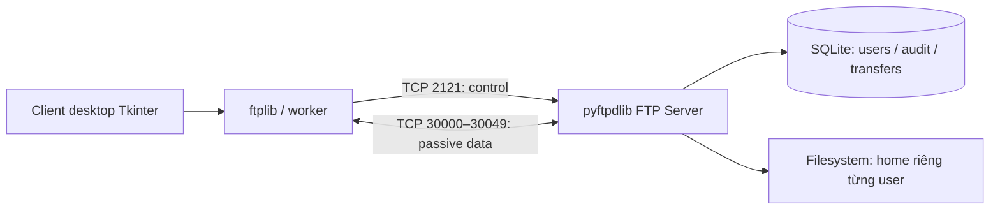

# FTP Server & Client — Lab 2

Ứng dụng truyền file qua **FTP chuẩn TCP**, gồm server có database **SQLite** và client desktop **Tkinter** theo mô hình hai khung của FileZilla. Dự án dùng **Python**, thiết kế để kết nối giữa **Windows và MacBook (macOS)** trên cùng mạng LAN.

**Repository:** [vunguyxxn/FTP-Server](https://github.com/vunguyxxn/FTP-Server) · **Python:** 3.11 · **FTP library:** pyftpdlib 2.1.0 · **Database:** SQLite · **Giao diện:** Tkinter/ttk

### Bắt đầu từ GitHub

```bash
git clone https://github.com/vunguyxxn/FTP-Server.git
cd FTP-Server
```

Sau khi clone, thư mục gốc là `FTP-Server`. Trong những ví dụ dùng đường dẫn `E:\Download\FTP` hoặc `~/Downloads/FTP` phía dưới, thay bằng nơi bạn vừa clone dự án.

**Windows — mở PowerShell tại thư mục repository:**

```powershell
python -m venv .venv
.\.venv\Scripts\python.exe -m pip install -r requirements.txt
.\.venv\Scripts\python.exe manage.py add-user student
.\.venv\Scripts\python.exe server.py
```

Mở terminal thứ hai tại cùng thư mục để chạy client:

```powershell
.\.venv\Scripts\python.exe client.py
```

**macOS — mở Terminal tại thư mục repository:**

```bash
python3 -m venv .venv
.venv/bin/python -m pip install -r requirements.txt
.venv/bin/python manage.py add-user student
.venv/bin/python server.py
```

Mở terminal thứ hai, chạy `.venv/bin/python client.py`. Nếu Mac chỉ làm client kết nối Windows thì chỉ cần cài môi trường và chạy client, không tạo tài khoản hoặc chạy server tại Mac.

**Thử cùng máy:** host `127.0.0.1`, port `2121`, user `student`, mật khẩu tự tạo. **Thử khác máy:** host là IP LAN của máy server; mở cổng điều khiển và passive theo phần 4. Không có tài khoản/mật khẩu mặc định trong repository.

### Tài liệu dự án

| Tài liệu | Nội dung |
|---|---|
| [README](#1-đối-chiếu-yêu-cầu) | Yêu cầu, cài đặt, kết nối hai máy, kiểm thử và xử lý lỗi |
| [Báo cáo và demo](docs/BAO_CAO.md) | Thiết kế, database, luồng FTP, câu hỏi bảo vệ, bảng ghi kết quả |
| [Ghi chú vận hành](docs/GHI_CHU.md) | Những điều cần chuẩn bị và giới hạn cần nắm trước khi chấm |
| [Kết quả kiểm thử](docs/KET_QUA_KIEM_THU.md) | Kết quả đã xác nhận và phần chưa kiểm chứng trực tiếp |
| [Lịch sử thay đổi](CHANGELOG.md) | Các chức năng của bản đầu tiên |

### Kiến trúc tổng quan



Server và client có thể chạy cùng máy để thử nhanh hoặc trên hai máy khác hệ điều hành. Server mặc định nghe trên mọi interface ở cổng 2121; không cần quyền root để bind cổng này trên macOS. Thiết lập firewall chỉ cần cho máy đóng vai trò server trong mô hình passive của client đi kèm.

Bài làm theo **dòng Lab 2 trong ảnh**: “FTP Server(kk) hoặc FTP Client”, yêu cầu “Có giao thức FTP”, cách chấm “Server có database”, ghi chú “Tương tự FileZilla”. Triển khai cả server và client để demo trọn vẹn trên hai máy thật. Không có thang điểm số cụ thể trong ảnh nên không tự gán điểm.

## 1. Đối chiếu yêu cầu

| Nội dung trong ảnh | Phần thực hiện | Minh chứng khi demo |
|---|---|---|
| FTP Server hoặc FTP Client | Có cả `server.py` và `client.py` | Hai tiến trình kết nối qua IP LAN |
| Có giao thức FTP | Server dùng pyftpdlib, client dùng ftplib, truyền qua TCP chuẩn FTP | Nhật ký USER, PASS được che, PASV, MLSD, STOR, RETR, RNFR/RNTO, DELE |
| Server có database | SQLite thật: `users`, `audit`, `transfers` | Dùng `manage.py users/logs/transfers`, kiểm tra sau khi khởi động lại |
| Tương tự FileZilla | Hai khung local/remote, thanh kết nối, tiến độ, nhật ký | Upload/download, tạo thư mục, đổi tên, xóa |
| Kết nối MacBook và Windows | Python + Tkinter đa nền tảng, FTP passive, UTF-8 | Truyền file giữa hai máy theo phần 4 |

Yêu cầu chạy 5–6 client ở ảnh thuộc **Lab 1**. Lab 2 vẫn có bài kiểm thử bổ sung cho 6 phiên FTP đồng thời. Không cần làm chat, multicast hoặc audio/video cho Lab 2.

## 2. Cấu trúc và chức năng

```text
FTP/
├── server.py             FTP server, xác thực, callback ghi lịch sử
├── client.py             Giao diện Tkinter hai khung, worker truyền file
├── database.py           Schema SQLite, băm mật khẩu, truy vấn có tham số
├── manage.py             Tạo tài khoản và xem database tại máy server
├── requirements.txt      pyftpdlib==2.1.0
├── setup-windows.cmd     Cài môi trường riêng trên Windows
├── setup-macos.sh        Cài môi trường riêng trên macOS
├── run-*.cmd / run-*.sh   Chạy sau khi cài và tạo tài khoản
├── tests/                Kiểm thử socket thật và giao diện
├── docs/BAO_CAO.md       Nội dung báo cáo, câu hỏi và kịch bản chấm
└── data/                 Tự sinh khi tạo tài khoản, không có sẵn trong gói
    ├── ftp.sqlite3       Database chỉ đặt trên server
    └── homes/student/    File thật của tài khoản student
```

Mỗi tài khoản có thư mục gốc riêng. Tài khoản thường được upload/download, tạo/xóa thư mục rỗng, đổi tên/xóa file. Tài khoản `--readonly` chỉ liệt kê và tải file. Database lưu tài khoản với mật khẩu PBKDF2-HMAC-SHA256 + salt ngẫu nhiên; nhật ký không lưu mật khẩu rõ. File nằm trên filesystem; database lưu đường dẫn, kích thước, chiều truyền, thời điểm, kết quả và sự kiện. Các thời điểm database dùng UTC.

## 3. Cài đặt trên cả hai máy

Chép hoặc giải nén **mã nguồn** vào mỗi máy. Tạo `.venv` riêng trên từng máy; không chép `.venv` Windows sang macOS. Dùng Python 3.11 có Tkinter để gần với môi trường đã kiểm thử. Có thể dùng bộ cài Python từ [python.org](https://www.python.org/downloads/). Kiểm tra Tkinter trước bằng `python -m tkinter` trên Windows hoặc `python3 -m tkinter` trên Mac: phải hiện cửa sổ thử Tk. Xem [tài liệu Tkinter](https://docs.python.org/3/library/tkinter.html).

### Windows — PowerShell, tại thư mục chứa bài

```powershell
cd E:\Download\FTP
python -m venv .venv
.\.venv\Scripts\python.exe -m pip install -r requirements.txt
```

Hoặc chạy `setup-windows.cmd`. Các lệnh dùng trực tiếp Python trong `.venv`, không cần đổi ExecutionPolicy hoặc activate.

### MacBook — Terminal, tại thư mục giải nén

```bash
cd ~/Downloads/FTP
python3 -m venv .venv
.venv/bin/python -m pip install -r requirements.txt
```

Hoặc `sh setup-macos.sh`. Nếu thiếu `_tkinter`, dùng bản Python có kèm Tk rồi tạo lại môi trường; không cài bằng `pip install tkinter`. macOS có thể hỏi quyền truy cập Documents/Downloads khi duyệt file; cấp quyền cho ứng dụng Terminal/Python đang chạy nếu cần.

## 4. Kết nối Windows làm server, MacBook làm client

### Bước A — Cùng mạng LAN

Cho hai máy vào cùng Wi-Fi/router hoặc cùng mạng Ethernet. Tránh Wi-Fi Guest hoặc Wi-Fi có AP/client isolation. Ví dụ Windows `192.168.1.10`, MacBook `192.168.1.20` với subnet mask `/24`.

```text
MacBook: client.py                 Windows: server.py
192.168.1.20                       192.168.1.10
      ├──── TCP 2121 ───────────────► lệnh / phản hồi FTP
      └──── TCP 30000–30049 ────────► kênh dữ liệu passive
                                       ├── data/ftp.sqlite3
                                       └── data/homes/student/
```

`0.0.0.0` là địa chỉ bind của server; client phải nhập **IP LAN của máy server**, không nhập `0.0.0.0` hoặc `127.0.0.1`. `127.0.0.1` chỉ dùng khi client và server trên cùng máy.

### Bước B — Tạo tài khoản trên Windows

```powershell
.\.venv\Scripts\python.exe manage.py add-user student
```

Nhập mật khẩu ít nhất 8 ký tự hai lần. Khi nhập bằng terminal sẽ không hiện ký tự. Không có mật khẩu mặc định. Tạo thêm tài khoản chỉ đọc để demo phân quyền:

```powershell
.\.venv\Scripts\python.exe manage.py add-user viewer --readonly
```

Hai tài khoản có home riêng. Muốn demo `viewer` tải được file, chép sẵn một file mẫu vào `data/homes/viewer/` trên server. Khi tạo tài khoản mới trong lúc server đang chạy, khởi động lại server để nạp danh sách tài khoản.

### Bước C — Cho phép cổng trên Windows server

Kiểm tra mạng hiện tại bằng `Get-NetConnectionProfile`. Trên LAN tin cậy dùng network profile **Private** trong Windows Settings. Sau đó mở PowerShell **Run as administrator**, chạy:

```powershell
New-NetFirewallRule -DisplayName "Lab2 FTP Control" -Direction Inbound -Action Allow -Protocol TCP -LocalPort 2121 -Profile Private -RemoteAddress LocalSubnet
New-NetFirewallRule -DisplayName "Lab2 FTP Passive" -Direction Inbound -Action Allow -Protocol TCP -LocalPort 30000-30049 -Profile Private -RemoteAddress LocalSubnet
```

Không cần tắt toàn bộ firewall. Chỉ máy đóng vai trò server cần nhận hai loại kết nối vào trong chế độ passive. Các rule trên giới hạn mạng Private và máy cùng subnet. Cách dùng tham số theo [Microsoft New-NetFirewallRule](https://learn.microsoft.com/powershell/module/netsecurity/new-netfirewallrule).

Xong bài, có thể gỡ các rule đã tạo:

```powershell
Remove-NetFirewallRule -DisplayName "Lab2 FTP Control"
Remove-NetFirewallRule -DisplayName "Lab2 FTP Passive"
```

### Bước D — Khởi động server và lấy IP

```powershell
ipconfig
.\.venv\Scripts\python.exe server.py
```

Chọn IPv4 của Wi-Fi/Ethernet đang dùng trong `ipconfig`, tránh địa chỉ của VPN, Docker hay VMware. Server mặc định bind `0.0.0.0:2121`, PASV `30000–30049`. Giữ cửa sổ server mở; `Ctrl+C` để dừng.

### Bước E — MacBook kết nối

```bash
nc -vz 192.168.1.10 2121
.venv/bin/python client.py
```

Thay `192.168.1.10` bằng IP thực. Trên giao diện nhập:

| Trường | Giá trị |
|---|---|
| Host / IP server | IP LAN của Windows |
| Port | `2121` |
| Tài khoản | `student` |
| Mật khẩu | Mật khẩu vừa tạo trên Windows |

Bấm **Kết nối**. Khung phải hiện `/`. Bên trái chọn thư mục local và chọn một file rồi bấm **Tải lên →**. Chọn file bên phải, chọn thư mục local khác ở bên trái rồi bấm **← Tải xuống**. Nháy đúp thư mục để vào, nút `↑ Thư mục cha` để đi lên. Các thao tác tạo, đổi tên và xóa áp dụng cho khung server; xóa thư mục yêu cầu thư mục rỗng.

### Đổi vai: MacBook server, Windows client

Trên Mac:

```bash
.venv/bin/python manage.py add-user student
.venv/bin/python server.py
```

Xem IP của mạng đang dùng trong **System Settings → Network → Wi-Fi/Ethernet → Details → TCP/IP**. Nếu firewall bật, cho phép Python đang chạy server nhận incoming connections trong **System Settings → Network → Firewall → Options**. Theo [hướng dẫn firewall của Apple](https://support.apple.com/guide/mac-help/block-connections-to-your-mac-with-a-firewall-mh34041/mac).

Trên Windows:

```powershell
Test-NetConnection 192.168.1.20 -Port 2121
.\.venv\Scripts\python.exe client.py
```

Client nhập IP của MacBook. Tài khoản và database phải tạo ở **máy chạy server**; không cần sao chép database sang máy client. Hai chiều upload/download đều hoạt động khi giữ nguyên vai server/client; không cần đổi vai chỉ để gửi file ngược lại.

## 5. Kiểm tra bằng FileZilla

Dùng FileZilla Client để kiểm chứng server độc lập với GUI tự viết:

- Protocol: FTP — File Transfer Protocol.
- Host: IP LAN của server; Port: `2121`.
- Encryption: Only use plain FTP (insecure), vì bài này là FTP thường, chưa triển khai FTPS.
- Logon Type: Normal; nhập tài khoản trong SQLite.
- Transfer Settings: Passive.

Không chọn SFTP (giao thức khác). Client tự viết dùng MLSD để liệt kê nên hướng tới server của bài và server hỗ trợ MLSD; chưa có fallback LIST cho server FTP cũ.

## 6. Xem database và lịch sử để chấm

Trên Windows server:

```powershell
.\.venv\Scripts\python.exe manage.py users
.\.venv\Scripts\python.exe manage.py logs
.\.venv\Scripts\python.exe manage.py transfers
```

Trên Mac server thay tiền tố Python bằng `.venv/bin/python`. Hai lệnh lịch sử hiển thị 50 bản ghi mới nhất. Có thể mở `data/ftp.sqlite3` bằng công cụ đọc SQLite để xem trực tiếp ba bảng; không sửa DB trong lúc server đang chạy.

Ví dụ truy vấn khi bảo vệ:

```sql
SELECT username, permissions, home FROM users;
SELECT time, username, ip, direction, path, bytes, status
FROM transfers ORDER BY id DESC LIMIT 20;
SELECT time, username, event, detail FROM audit ORDER BY id DESC LIMIT 30;
```

Dừng server rồi chạy lại: tài khoản, file, lịch sử vẫn còn. Nếu đổi vị trí toàn bộ thư mục bài sau khi tạo tài khoản, cột `users.home` đang lưu đường dẫn tuyệt đối; nên tạo lại tài khoản trong một thư mục dữ liệu mới bằng `manage.py --data <thư_mục_mới> add-user student` rồi chạy `server.py --data <thư_mục_mới>`. Không xóa dữ liệu cũ khi còn cần file/lịch sử.

## 7. Kiểm thử

```powershell
# Windows
.\.venv\Scripts\python.exe -m unittest discover -s tests -p test_ftp.py -v
.\.venv\Scripts\python.exe tests/test_gui.py
```

```bash
# macOS — cần phiên desktop để chạy test_gui.py
.venv/bin/python -m unittest discover -s tests -p test_ftp.py -v
.venv/bin/python tests/test_gui.py
```

Test dùng database tạm và server localhost với cổng điều khiển tự chọn; không sửa tài khoản/file trong `data/` của bài. Kiểm tra đăng nhập đúng/sai, UTF-8, file nhị phân 2 MiB và file rỗng, upload/download cùng hash, CRUD, quyền chỉ đọc, chặn đọc DB ngoài home, 6 client, lịch sử database và active mode. GUI smoke test dựng cửa sổ Tk thật, kết nối, upload/download file tiếng Việt rồi ngắt.

Đã chạy đạt các kiểm thử trên **Windows / Python 3.11.3 / Tk 8.6**. Chưa kiểm chứng trực tiếp trên MacBook hoặc đường truyền giữa hai máy thật trong phiên xây dựng này. Cần thực hiện phần 4 tại mạng của bạn để xác nhận liên thông thực tế.

## 8. Xử lý sự cố

| Hiện tượng | Kiểm tra / xử lý |
|---|---|
| Connection refused | Server chưa chạy, sai IP/cổng hoặc tiến trình đã dừng; xem terminal server |
| Timeout ngay lúc kết nối | Cổng 2121/firewall, mạng Guest, AP isolation, VPN hoặc khác subnet |
| Login được nhưng không thấy file / truyền bị treo | Kiểm tra cổng passive 30000–30049 trên server; đây là kênh dữ liệu riêng |
| `530` | Sai tài khoản/mật khẩu, hoặc tài khoản mới chưa được nạp; restart server |
| `550` | Không tồn tại, thiếu quyền, tên trùng, thư mục chưa rỗng hoặc đang bị hệ điều hành khóa |
| `Address already in use` | Đã có server khác chạy cổng 2121; dừng bản cũ hoặc đổi `--port`, cập nhật client/firewall |
| `No module named pyftpdlib` | Chạy Python đúng `.venv` và cài `requirements.txt` |
| Không hiện GUI / thiếu `_tkinter` | Cài Python có Tk, kiểm tra `python3 -m tkinter` rồi tạo lại `.venv` |
| FTP bị ngắt sau lỗi | Client chủ động đóng phiên sau lỗi để tránh lệch phản hồi; bấm kết nối lại |
| File upload bị gián đoạn | Có thể để lại file một phần trên server, lịch sử `INCOMPLETE`; xóa hoặc upload ghi đè lại |

Không kiểm tra PASV bằng cách quét cổng 30000 lúc rảnh: server mở listener dữ liệu khi có lệnh PASV, không giữ tất cả cổng luôn lắng nghe. Client mở thư mục/transfer thành công mới là kiểm chứng đầy đủ. Hai máy cùng LAN thường không cần `--advertise-ip`; chỉ dùng tùy chọn này khi hiểu địa chỉ server cần công bố.

## 9. Phạm vi bài và tài liệu tham khảo

Đây là FTP thường phục vụ lab LAN: thông tin đăng nhập và dữ liệu đi trên mạng chưa mã hóa. Dùng mật khẩu riêng cho bài, không dùng mật khẩu tài khoản cá nhân. Bài chưa có FTPS/SFTP, tiếp tục truyền file, đồng bộ thư mục đệ quy hoặc hàng đợi đa file. Download dùng file tạm rồi thay thế sau khi truyền xong; upload trực tiếp STOR nên file cũ có thể bị thay một phần nếu ghi đè thất bại. GUI hỏi xác nhận trước khi ghi đè/xóa, nhưng chưa khóa cạnh tranh khi hai client cùng sửa một file.

Các thư viện hiện thực giao thức FTP được sử dụng công khai, không tự viết lại parser TCP. Nếu giảng viên yêu cầu tự hiện thực FTP hoàn toàn bằng socket, cần xác nhận thêm vì ảnh không nêu điều đó. Đọc luồng và vị trí mã cần giải thích trong [docs/BAO_CAO.md](docs/BAO_CAO.md).

### Tham số và quản trị

```text
python server.py --help
python manage.py --help
python server.py --host 0.0.0.0 --port 2121 --passive-start 30000 --passive-end 30049
python manage.py --data /duong-dan/data add-user student
python server.py --data /duong-dan/data
```

Với thư mục dữ liệu tùy chọn, dùng cùng `--data` ở cả `manage.py` và `server.py`; tham số `--data` của `manage.py` đứng trước tên lệnh. Không chạy hai server cùng dùng cổng mặc định. Đổi port phải cập nhật cả client và firewall. Server cho phép tối đa 100 kết nối tổng và 20 kết nối mỗi IP; thời gian idle của phiên là 300 giây. Socket client timeout mặc định 20 giây.

### Đóng góp và chia sẻ

Khi sửa code, chạy lại các bài kiểm thử phù hợp, cập nhật tài liệu nếu đổi cổng hoặc cách chạy, và mô tả rõ môi trường đã kiểm chứng. Chỉ commit mã nguồn và tài liệu. `.gitignore` loại `.venv`, `data/`, database, log, file tạm, ZIP đóng gói và `.env` để tài khoản/file cá nhân không đi vào Git. Database cần được tạo lại trên máy server sau khi clone. Repository hiện chưa chỉ định giấy phép mã nguồn; không tự suy ra giấy phép từ việc xem được code công khai.

- [pyftpdlib tutorial](https://pyftpdlib.readthedocs.io/en/latest/tutorial.html): dựng server và cấu hình handler.
- [pyftpdlib API](https://pyftpdlib.readthedocs.io/en/latest/api.html): authorizer, passive ports, transfer callbacks.
- [Python ftplib](https://docs.python.org/3.12/library/ftplib.html): client FTP chuẩn, binary transfer, passive mode.
